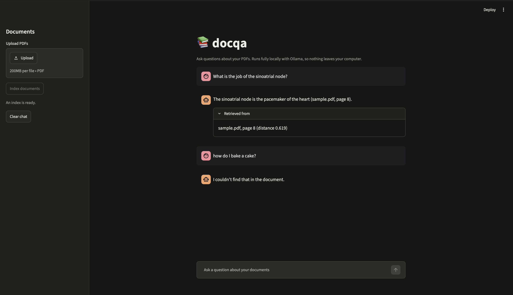

# docqa: Local PDF Question Answering with RAG

A command-line tool and web app that answers questions about your PDFs using Retrieval-Augmented Generation (RAG), running **entirely on your own machine**. No API keys, no cloud services, and your documents never leave your computer.



## Features

- **Fully local:** Ollama runs both the embedding model and the chat model
- **File and page citations:** every answer says which file and page it came from, written by code rather than the model, so they cannot be misspelt or invented
- **Stays on topic:** a distance cutoff plus a strict prompt make it refuse questions the document can't answer
- **Multiple PDFs:** index a single file or a whole folder
- **Persistent index:** index your PDFs once, ask as many questions as you like
- **Web interface:** a Streamlit chat page with PDF upload and an expandable list of the files and pages each answer drew on
- **Clean structure:** all settings live in one config file

## How it works

```
INDEXING   PDFs -> pypdf (one Document per page)
               -> RecursiveCharacterTextSplitter (500 chars, 100 overlap)
               -> nomic-embed-text (vectors)
               -> ChromaDB (saved to disk)

ASKING     question -> embed -> 8 nearest chunks from ChromaDB
                    -> drop chunks above the distance cutoff
                    -> prompt (question + chunks + rules)
                    -> gemma3:12b -> answer citing numbered passages
                    -> code swaps passage numbers for real (file, page)
```

If no chunk is close enough to the question, the language model is never called and the tool says it couldn't find the answer.

## Prerequisites

- Python 3.10 or newer (developed and tested on 3.12)
- [Ollama](https://ollama.com/download) installed and running

## Setup

```bash
git clone https://github.com/vedasaikanduri/doc-qa-rag.git
cd doc-qa-rag

python3.12 -m venv .venv
source .venv/bin/activate
pip install -r requirements.txt

ollama pull nomic-embed-text
ollama pull gemma3:12b
```

## Usage

Put one or more text-based PDFs in the `data/` folder, then index them and ask questions. Indexing rebuilds the index from scratch each time:

```bash
python -m docqa index data/your-file.pdf   # one PDF
python -m docqa index data                 # every PDF in the folder
python -m docqa ask "your question here"
```

Questions the document can't answer get a refusal instead of a made-up reply:

```
$ python -m docqa ask "who won the world cup?"
I couldn't find that in the document.
```

Run `python -m docqa --help` for all commands.

### Web interface

```bash
streamlit run app.py
```

This opens a chat page in your browser (http://localhost:8501). Upload one or more PDFs in the sidebar, click **Index documents**, then ask questions. Each answer has a **Retrieved from** box listing the files and pages the passages came from. Uploaded files are saved to a local `uploads/` folder, which is git-ignored.

## Configuration

Edit `docqa/config.py`:

| Setting | Meaning |
|---|---|
| `CHAT_MODEL` / `EMBED_MODEL` | Which Ollama models to use |
| `CHUNK_SIZE` / `CHUNK_OVERLAP` | How the text is split (characters) |
| `TOP_K` | How many chunks to retrieve per question |
| `MAX_DISTANCE` | Cutoff above which chunks count as irrelevant (lower = closer match) |

## Project structure

```
app.py             Streamlit web interface
docqa/
  __main__.py   command-line interface
  config.py     settings and the system prompt
  loader.py     PDF to per-page Documents
  pipeline.py   indexing and question answering
  evaluate.py   retrieval evaluation and cutoff sweep
  experiments.py  compares chunk sizes
eval/
  questions.json  hand-written test questions
```

## Evaluation and experiments

`docqa/evaluate.py` checks retrieval against a hand-written test set (`eval/questions.json`): 19 questions whose answers are on known pages, and 8 off-topic questions the document does not answer (3 clearly unrelated, 5 nearby biology topics that sound relevant but are not covered). The test set was written for one document (AQA A-level Biology notes, not included in this repo), so the page numbers only match that PDF. To reuse the scripts, replace the questions with ones for your own document. The scripts check page numbers only, so index just the document the questions were written for first (for example `python -m docqa index data/sample.pdf`), otherwise pages from other files can interfere.

```bash
python -m docqa.evaluate      # retrieval check and cutoff sweep
python -m docqa.experiments   # compares chunk sizes
```

### Experiment 1: chunk size

`docqa/experiments.py` builds a temporary index for each chunk size (overlap set to 20% of the size) and measures two things. **hit@k** is the number of answerable questions where a chunk from the correct page appears in the top k results. The **margin** is the gap between the worst-scoring answerable question and the closest-scoring off-topic question (distance, lower means closer). A positive margin means some cutoff separates the two groups perfectly, and a bigger margin means a safer cutoff.

| Chunk size | Chunks | hit@1 | hit@2 | hit@4 | hit@6 | Worst answerable | Closest off-topic | Margin |
|---|---|---|---|---|---|---|---|---|
| 500 | 89 | 17/19 | 19/19 | 19/19 | 19/19 | 0.619 | 0.748 | +0.128 |
| 1000 | 44 | 19/19 | 19/19 | 19/19 | 19/19 | 0.734 | 0.776 | +0.042 |
| 1500 | 31 | 18/19 | 19/19 | 19/19 | 19/19 | 0.792 | 0.763 | -0.030 |

- The correct page was in the top 2 results for every question at every chunk size, so finding the right page was never the problem. Only hit@1 differs, by one or two questions, which is a hint rather than strong evidence.
- The margin separated the settings best. At 1500 the two groups overlap, so no cutoff can work. At 500 the gap is about three times wider than at 1000.
- Each margin depends on just two questions (the worst answerable and the closest off-topic), so it is fragile.

### Experiment 2: retrieval depth (TOP_K)

Because the correct page is always found within the top 2, `TOP_K` mostly controls how much context the language model receives. With 500-character chunks, `TOP_K=8` gives roughly the same amount of text as `TOP_K=4` did with 1000-character chunks, so I changed both together.

### Final settings and end-to-end check

Chosen settings: chunk size 500, overlap 100, `TOP_K=8`, `MAX_DISTANCE=0.7`. The cutoff sweep with these settings (answerable questions kept / off-topic questions wrongly passed):

| Cutoff | Answerable kept | Off-topic passed |
|---|---|---|
| 0.6 | 17/19 | 0/8 |
| **0.7** | **19/19** | **0/8** |
| 0.8 | 19/19 | 2/8 |
| 0.9 | 19/19 | 5/8 |
| 1.0 | 19/19 | 5/8 |
| 1.1 | 19/19 | 6/8 |
| 1.2 | 19/19 | 8/8 |

I also read the full answers to a few questions before and after the change (judged by eye, not a systematic measurement):

- **Off-topic:** with the earlier settings (1000 / top 4 / cutoff 0.8), a nearby off-topic question (kidney filtration) got past the cutoff and was refused only by the language model. With the final settings the cutoff blocks it before the model is called.
- **Broad question** ("how do plants move water?"): the answer became more complete, adding root pressure and cohesion.
- **Narrow question** ("what is the job of the sinoatrial node?"): the answer became shorter and lost a detail it used to include. My guess, which I have not verified, is that the missing sentence sits in a neighbouring chunk that falls just outside the cutoff.

### Caveats

- The cutoff and chunk size were tuned on the same 27 questions they were measured on, so the numbers are optimistic.
- One document and a small test set. The settings may not transfer to other documents.
- The evaluation checks which page is retrieved, not whether the final answer is complete or correct.

## Design notes

**Citations are written by code, not by the model.** An early version asked the model to cite `(file, page)` itself. It copied the example from the prompt instead of reading the real label: first it cited a file name that did not exist, and when the example was changed to a placeholder it printed the placeholder literally. Now each retrieved chunk is given a number, the model cites numbers like `[3]`, and the code replaces each number with the real file and page from the chunk's metadata. A citation can no longer be misspelt or invented.

**Logic and interface are separate.** `docqa/pipeline.py` returns answers instead of printing them, so the command-line tool and the Streamlit app are thin layers over the same functions. Re-indexing clears the Chroma collection rather than deleting its folder, to avoid problems with a long-running app that may still have the database open.

**The chain is built by hand.** The task suggested LangChain's `RetrievalQA` helper. I wrote the same steps explicitly (retrieve, filter by distance, build the prompt, call the model) so that the cutoff, the numbered passages and the citation swap are easy to see and control.

**Two layers keep answers on topic.** A distance cutoff stops clearly unrelated questions before the model is called, and a strict prompt makes the model refuse when the retrieved text does not answer the question.

## Limitations

- Re-indexing rebuilds the whole index, so adding one file means re-embedding all of them
- Citations depend on the model using the passage numbers it is given; a number that does not match a passage is left as written
- The web app shows the chat history but answers each question on its own, with no conversation memory, so follow-ups such as "why is that?" will not work
- When several retrieved chunks come from the same page, the same citation can appear more than once in an answer
- Text-based PDFs only; scanned documents would need OCR
- `MAX_DISTANCE` was tuned on a small test set of 27 questions written by me, so it may not generalise to other documents
- Smaller chunks plus a strict cutoff can make answers to narrow questions shorter, because neighbouring chunks just outside the cutoff are dropped
- Text is split per page, so an idea that runs across a page break is cut there
- The *Sources* list shows the chunks that were retrieved, not necessarily every one the model used

## Roadmap

- Use the cutoff only to decide whether to answer, then pass all top-K chunks to the model (may restore detail lost to smaller chunks)
- Index new files without rebuilding the whole index
- Conversation memory so follow-up questions work

## Note on documents

PDFs in `data/` are git-ignored. Bring your own, and respect the copyright of anything you index.

## Licence

MIT. See [LICENSE](LICENSE).
